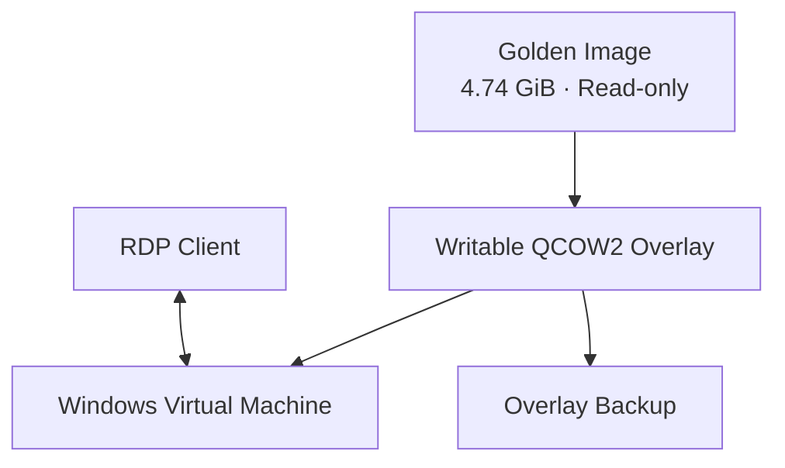

# Windows 10 Golden Image


A lightweight, debloated and performance-oriented Windows 10
golden image designed for QEMU/KVM virtualization, disposable
environments and persistent overlay-based virtual machines.

The image is intended to serve as an immutable foundation for
custom Windows environments without reinstalling or configuring
the operating system from scratch.

## System specifications

| Property | Value |
|---|---|
| Operating system | Windows 10 IoT Enterprise LTSC 2021 |
| Windows version | 21H2 |
| Base build | 19044.1288 |
| Architecture | x86-64 |
| Language | English (United States) |
| Virtual disk capacity | 64 GiB |
| Allocated disk size | 4.74 GiB |
| Image format | QCOW2 |
| Compression | Zstandard |
| Cluster size | 64 KiB |
| Firmware | UEFI / OVMF |
| TPM | Emulated TPM 2.0 |
| Hypervisor | QEMU/KVM |
| Machine type | Q35 10.0 |
| Activation | Massgrave (MAS) |
| Remote access | RDP |

## Features

- Minimal Windows LTSC installation.
- Preinstalled VirtIO drivers.
- Debloated operating system.
- Performance-oriented Windows configuration.
- Remote Desktop configured for up to 60 FPS.
- CompactOS enabled.
- TRIM and discard support.
- Zstandard-compressed QCOW2 image.
- Immutable base image with writable overlays.
- Preserved UEFI and TPM state.
- Configurable CPU and memory allocation.
- Intended for GitHub Actions and local QEMU/KVM hosts.

## Windows optimizations

### System debloating

The operating system has been debloated using
[Windows10Debloater](https://github.com/Sycnex/Windows10Debloater).

Unnecessary consumer-oriented components, background activities
and optional services have been reduced to minimize resource
consumption.

### Performance

- Windows visual effects reduced for best performance.
- High-performance power configuration.
- Unnecessary background applications restricted.
- Windows transparency effects disabled.
- Game DVR and background recording disabled.
- Unnecessary indexing and background services reduced.
- Hibernation disabled.
- Automatic sleep disabled.
- Consumer content and suggestions disabled.
- Windows reserved storage disabled.
- Windows component store cleaned.
- CompactOS system file compression enabled.

### Virtualization

- Hardware-assisted KVM acceleration.
- Host CPU passthrough.
- Hyper-V enlightenments.
- VirtIO SCSI storage controller.
- VirtIO network adapter.
- VirtIO memory ballooning.
- Q35 PCI Express topology.
- UEFI firmware with Microsoft keys.
- Emulated TPM 2.0.
- USB tablet input.
- QMP management interface.
- Virtual VGA display.

### Remote Desktop

Remote Desktop is enabled and configured for performance.

- Target frame rate of up to 60 FPS.
- DWM frame interval configured to 15 ms.
- AVC444 mode preferred.
- RDP service enabled automatically.
- Windows Firewall RDP rules enabled.
- Clipboard redirection through the RDP client.

Actual frame rate and encoding performance depend on the host,
network connection and RDP client.

## Disk optimization

The virtual disk was optimized through multiple stages:

| Stage | Allocated size |
|---|---:|
| Initial optimized installation | 9.0 GiB |
| After ReTrim | 6.4 GiB |
| After Zstandard compression | 4.74 GiB |

**Total storage reduction: approximately 47%.**

The virtual disk retains its full 64 GiB capacity.

Image integrity was verified using:

- `qemu-img check`
- `qemu-img compare`
- SHA-256 checksums
- Successful Windows boot through a QCOW2 overlay
- Successful Remote Desktop connection

## Architecture



The golden image remains unchanged during normal operation.

All modifications are written to a separate QCOW2 overlay,
allowing the virtual machine to be reset, customized or backed
up independently of the base operating system.

A fresh overlay initially occupies approximately 196 KiB.

## Requirements

- Linux x86-64 host
- Hardware virtualization support
- Accessible `/dev/kvm`
- QEMU supporting `pc-q35-10.0`
- QEMU utilities
- OVMF firmware
- swtpm
- GitHub CLI
- Sufficient disk space

On Debian-based distributions:

```bash
sudo apt install qemu-system-x86 qemu-utils ovmf swtpm gh
```

The distribution-provided QEMU version must support the
configured machine type.

## Installation

Clone the repository:

```bash
git clone https://github.com/fox3000foxy/windows10-golden.git
cd windows10-golden
```

Download the release assets:

```bash
gh release download golden-v1.0
```

Reconstruct the golden image:

```bash
cat windows10-golden.qcow2.part-* > windows10-golden.qcow2
sha256sum -c windows10-golden.qcow2.sha256
```

Restore the virtual machine state:

```bash
tar -xzf vm-state.tar.gz
```

Protect the golden image:

```bash
chmod 444 windows10-golden.qcow2
```

Create a writable overlay:

```bash
qemu-img create -f qcow2 \
    -F qcow2 \
    -b windows10-golden.qcow2 \
    disk.qcow2
```

Start the virtual machine:

```bash
./boot-vm.sh
```

## Remote access

### RDP

The Windows installation contains a local account configured
without a password.

The default QEMU configuration forwards the guest RDP port
to the host loopback interface.

| Protocol | Host address | Port |
|---|---|---:|
| RDP | 127.0.0.1 | 3390 |
| VNC | 127.0.0.1 | 5900 |

For remote hosts, use SSH port forwarding:

```bash
ssh -N -L 3390:127.0.0.1:3390 user@host
```

Connect your RDP client to:

```text
127.0.0.1:3390
```

### ngrok TCP tunneling

An ngrok TCP tunnel can optionally provide remote access
to the RDP endpoint, including from a GitHub Actions runner.

However, the default passwordless Windows account must not
be exposed through an unrestricted public TCP endpoint.

Use an authenticated private access layer, or configure
appropriate account credentials and network access controls
before enabling an external tunnel.

ngrok integration is not included in the current boot script.

## Windows activation

The reference installation was activated using
[Massgrave (Microsoft Activation Scripts)](https://massgrave.dev/).

Activation status does not constitute a Windows license.
Users are responsible for obtaining the appropriate Microsoft
licensing rights for their deployment.

Activation persistence across different virtual hardware
configurations is not guaranteed.

## GitHub Actions

The image is intended for use with GitHub Actions runners
supporting KVM acceleration.

The compressed base image can be downloaded from GitHub
Releases, reconstructed, verified and used as the backing
file for a disposable or persistent QCOW2 overlay.

AMD EPYC runner compatibility is a target and has not yet
been validated.

## Persistent virtual machines

This project is designed to complement
[vm-sync](https://github.com/fox3000foxy/vm-sync).

While this repository provides the immutable Windows base
image, vm-sync handles virtual machine lifecycle management,
overlay persistence, backups, restoration and compaction.

Existing overlays created from unrelated base images are
not compatible with this golden image.

## Validation

| Test | Status |
|---|---|
| Windows installation | Passed |
| VirtIO storage | Passed |
| VirtIO networking | Passed |
| Local QEMU/KVM boot | Passed |
| RDP connectivity | Passed |
| QCOW2 integrity | Passed |
| Golden image checksum | Passed |
| Overlay write isolation | Passed |
| AMD EPYC runner | Pending |
| GitHub Actions integration | Pending |
| Release state restoration | Pending |

## Security and licensing

This image is intended for trusted, isolated environments.

- Do not expose passwordless RDP directly to the Internet.
- Keep the golden image and TPM state private.
- Do not commit credentials or access tokens.
- Use separate writable state for each VM instance.
- Apply relevant Windows security updates before production use.
- Verify Microsoft licensing and redistribution rights.

Windows and its proprietary components remain the property
of their respective owners.

## Credits

- [Microsoft Windows](https://www.microsoft.com/windows)
- [QEMU](https://www.qemu.org/)
- [KVM](https://www.linux-kvm.org/)
- [VirtIO Windows Drivers](https://github.com/virtio-win/kvm-guest-drivers-windows)
- [Windows10Debloater](https://github.com/Sycnex/Windows10Debloater)
- [Massgrave](https://massgrave.dev/)
- [Zstandard](https://github.com/facebook/zstd)
- [vm-sync](https://github.com/fox3000foxy/vm-sync)

---

Built for lightweight, reproducible and persistent Windows
virtualization.
